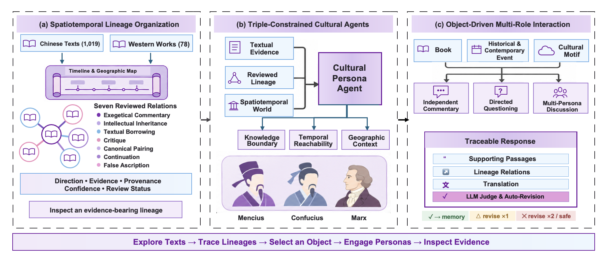

# Wenyuan Lineage

**Wenyuan Lineage** is an interactive cultural exploration system for tracing relationships among Chinese and Western texts and discussing them with historically situated persona agents.

[Live Demo](http://39.96.147.159/zhuzi-world-v1/) · [Source Code](./code/) · [Demo Video](./video/)



## Highlights

- **Spatiotemporal lineage exploration.** The system organizes 1,019 Chinese texts and 78 Western works through seven reviewed relation types: exegesis, inheritance, borrowing, critique, pairing, continuation, and attribution. Relations retain direction, evidence, provenance, confidence, and review status.
- **Triple-constrained cultural agents.** Persona responses are constrained by textual evidence, reviewed lineage relations, and spatiotemporal world knowledge. Supporting passages, translations, and consistency assessments remain inspectable.
- **Object-driven multi-role interaction.** Users can select a text, historical or contemporary event, or cultural motif for independent commentary, directed questioning, and multi-persona discussion.
- **Interactive cultural atlas.** Historical scrolls and geographic maps connect works, people, places, periods, and intellectual traditions across Chinese and Western contexts.

## Repository Structure

```text
.
├── code/    # application, data indexes, scripts, figures, and documentation
└── video/   # demonstration video
```

## Repository Scope

This repository contains the application, reviewed cultural-lineage indexes,
runtime evidence subsets, and the assets required by the public demonstration.
The complete source corpora, local research caches, failed evaluation runs,
model credentials, and deployment configuration are not included. A reviewed
evaluation report is retained under `code/docs/evaluation/` for reproducibility.

## Data Sources

The system integrates bibliographic and lineage evidence from the *Siku Quanshu Zongmu Tiyao*, person--work records from the China Biographical Database, historical coordinates from the China Historical GIS, and public-domain Western editions from Project Gutenberg. Modern and contemporary events are linked to their source records.

## Run Locally

Requirements: Node.js 22.13 or later.

```bash
cd code
npm install
cp .dev.vars.example .dev.vars
npm run dev
```

Add the required model credentials to `code/.dev.vars`. To create a production build:

```bash
cd code
npm run build
```

## Documentation

- [Lineage relation taxonomy](./code/docs/SIKU-RELATION-TAXONOMY.md)
- [Lineage review](./code/docs/siku-lineage-review.md)
- [External evaluation](./code/docs/EXTERNAL-EVAL.md)

